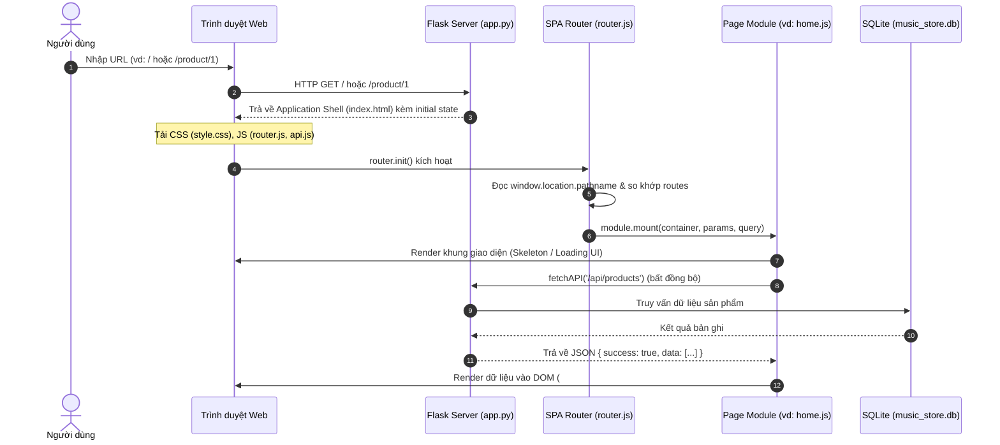
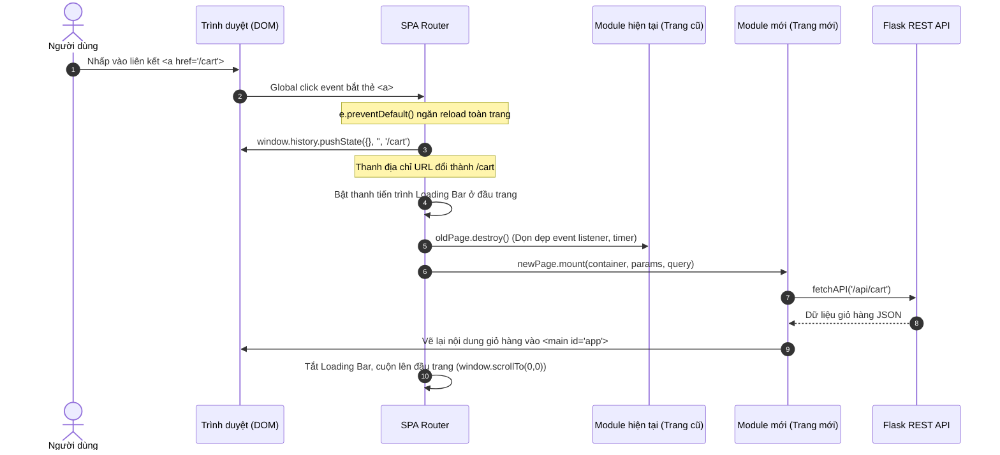
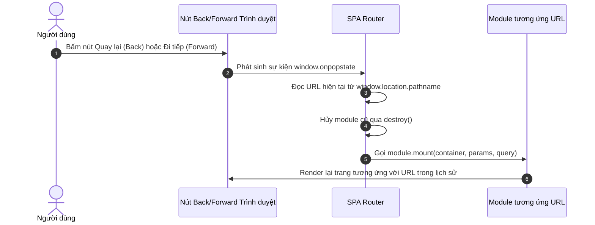
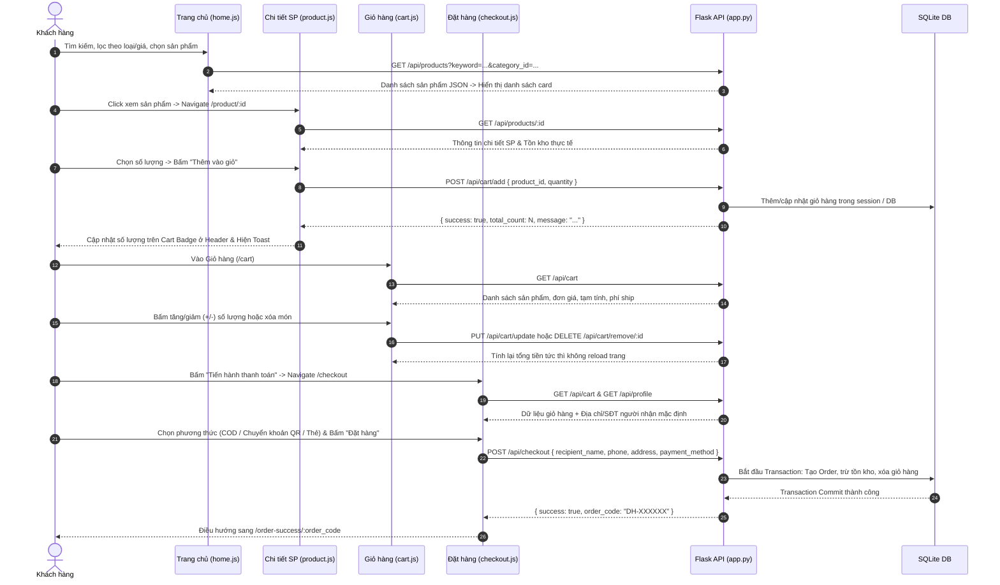
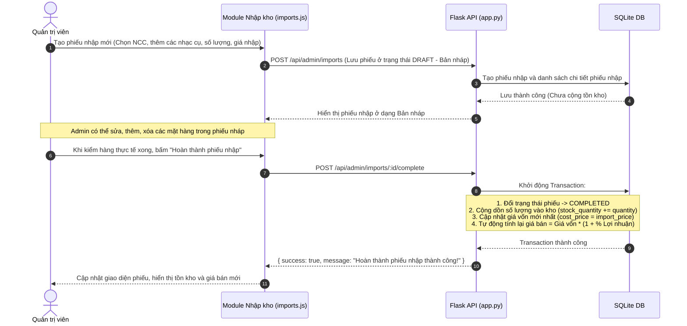
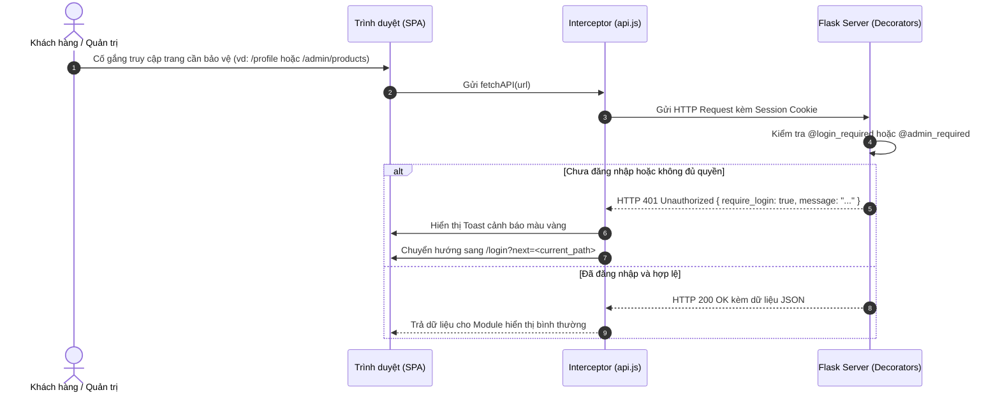

# Website Bán Dụng Cụ Âm Nhạc (Melody Store) - SPA Architecture

Dự án website thương mại điện tử chuyên kinh doanh nhạc cụ chính hãng (Guitar, Piano & Keyboard, Trống & Bộ gõ, Violin, Kèn & Sáo, Phụ kiện âm nhạc).
- **🌐 Website trực tuyến (Live Demo):** [https://shopnhaccu.onrender.com](https://shopnhaccu.onrender.com)
- **📦 Mã nguồn GitHub:** [https://github.com/Menk216/ShopNhacCu](https://github.com/Menk216/ShopNhacCu)
- **⚙️ Backend:** Python (Flask RESTful API, SQLite 3, Gunicorn)
- **🎨 Frontend:** Single Page Application (SPA) xây dựng bằng HTML5, CSS3, JavaScript Thuần (Vanilla ES6+ Modules, History API Router).

---

## 1. Hướng dẫn chạy ứng dụng

### Cách 1: Chạy nhanh bằng file `run.bat` (Khuyên dùng trên Windows)
- Nhấp đúp chuột vào file **`run.bat`** trong thư mục dự án. Hệ thống sẽ tự động cài đặt thư viện cần thiết, khởi tạo cơ sở dữ liệu mẫu và bật máy chủ.

### Cách 2: Chạy bằng dòng lệnh (Terminal / Command Prompt)
```bash
# 1. Cài đặt các thư viện phụ thuộc
pip install -r requirements.txt

# 2. Khởi tạo dữ liệu mẫu (nếu database chưa có dữ liệu)
python seed_data.py

# 3. Khởi chạy máy chủ Flask
python app.py
```

Sau khi chạy, truy cập vào trình duyệt:
- **Trang Khách hàng (SPA Client):** [http://127.0.0.1:5000](http://127.0.0.1:5000)
- **Trang Quản trị (SPA Admin):** [http://127.0.0.1:5000/admin/login](http://127.0.0.1:5000/admin/login)

---

## 2. Tài khoản mặc định hệ thống

| Phân hệ | Tên đăng nhập | Mật khẩu | Ghi chú |
|---|---|---|---|
| **Admin tối cao (ID: 1)** | `admin` | `admin123` | Quản trị toàn quyền, được bảo vệ không thể bị khóa hoặc xóa |
| **Khách hàng mẫu** | `1` | `123456` | Tài khoản khách hàng có sẵn trong cơ sở dữ liệu |

---

## 3. Cấu trúc thư mục dự án (Kiến trúc SPA Chuẩn)

```text
ShopNhacCu/
├── app.py                      # Backend: Flask RESTful APIs, Session Auth, Routing Application Shells
├── database.py                 # Schema SQLite (8 bảng), kết nối DB & công thức định giá bán
├── seed_data.py                # Script nạp dữ liệu mẫu ban đầu (danh mục, nhạc cụ, tài khoản)
├── music_store.db              # File cơ sở dữ liệu SQLite
├── requirements.txt            # Thư viện: Flask, Werkzeug
├── run.bat                     # File chạy tự động 1-click trên Windows
│
├── static/                     # TÀI NGUYÊN FRONTEND
│   ├── css/
│   │   ├── style.css           # CSS chung giao diện khách hàng (Layout, Grid, Responsive, Card)
│   │   ├── admin.css           # CSS giao diện quản trị (Sidebar, Topbar, Table, Form quản trị)
│   │   ├── login.css           # CSS giao diện đăng nhập / đăng ký khách hàng & quản trị
│   │   └── components.css      # CSS thành phần dùng chung (Modal, Toast, Error page, Utility classes)
│   └── js/
│       ├── api.js              # Hàm tiện ích chung: fetchAPI(), showToast(), formatVND(), formatDate()
│       ├── router.js           # SPA Router khách hàng (History API: pushState, popstate, Module Lifecycle)
│       ├── pages/              # CÁC MODULE CHỨC NĂNG KHÁCH HÀNG (ES6 Modules)
│       │   ├── home.js         # Trang chủ, tìm kiếm nâng cao đa tiêu chí, sắp xếp, phân trang, thêm giỏ
│       │   ├── product.js      # Chi tiết sản phẩm, chọn số lượng, kiểm tra tồn kho, thêm vào giỏ
│       │   ├── cart.js         # Giỏ hàng, tăng/giảm số lượng (+/-), xóa sản phẩm, tính tiền real-time
│       │   ├── checkout.js     # Đặt hàng, địa chỉ mặc định/mới, hình thức COD/Chuyển khoản QR/Thẻ
│       │   ├── order_success.js# Thông báo đặt hàng thành công, hiển thị tóm tắt đơn và mã đơn hàng
│       │   ├── orders.js       # Lịch sử đơn hàng, lọc theo trạng thái, thanh tiến trình, mua lại đơn cũ
│       │   └── profile.js      # Hồ sơ cá nhân, cập nhật SĐT, địa chỉ nhận hàng và đổi mật khẩu
│       │
│       └── admin/              # CÁC MODULE CHỨC NĂNG QUẢN TRỊ (ES6 Modules)
│           ├── admin-router.js # SPA Router quản trị (History API, Active Nav Highlighter, Loading Bar)
│           ├── dashboard.js    # Bảng điều khiển: Doanh thu, Đơn hàng, Tồn kho cảnh báo, Đơn mới nhất
│           ├── users.js        # Quản lý tài khoản: Thêm Admin mới, Đổi mật khẩu, Khóa/Mở khóa, Xóa khách
│           ├── categories.js   # Quản lý loại sản phẩm, % lợi nhuận định mức theo loại, ẩn/hiển thị
│           ├── products.js     # Quản lý danh mục sản phẩm, bộ lọc loại/tên, thêm/sửa modal, ẩn/hiện/xóa
│           ├── imports.js      # Quản lý nhập kho (Tạo/Sửa phiếu nháp nhiều mặt hàng -> Hoàn thành chốt kho)
│           ├── pricing.js      # Bảng giá & % Lãi: Cài đặt theo loại hoặc tùy chỉnh riêng từng sản phẩm
│           ├── orders.js       # Quản lý đơn hàng: Tìm kiếm, lọc theo ngày/trạng thái, cập nhật trạng thái
│           └── inventory.js    # Tra cứu tồn kho & Xuất báo cáo Nhập - Xuất - Tồn theo khoảng thời gian
│
└── templates/                  # DUY NHẤT 4 FILE HTML (.html) TRÊN TOÀN BỘ DỰ ÁN
    ├── index.html              # Application Shell dành cho Khách hàng (Header, Nav, Footer, #app)
    ├── admin.html              # Application Shell dành cho Quản trị viên (Sidebar, Topbar, #admin-app)
    ├── login.html              # Giao diện Xác thực phân tách theo vai trò: Khách hàng (2 tabs) & Quản trị viên (/admin/login)
    └── error.html              # Giao diện thông báo lỗi chung (404, 500,...)
```

---

## 4. Các tính năng nổi bật của kiến trúc SPA

### 1. Kiến trúc Application Shell & Render động hoàn toàn
- Mọi trang nội dung (trang chủ, chi tiết sản phẩm, giỏ hàng, thanh toán, lịch sử đơn, hồ sơ cá nhân, dashboard, quản lý sản phẩm, nhập hàng,...) đều được render động bằng **JavaScript Template Literals & DOM API** thông qua các ES Module độc lập.
- Khi chuyển đổi tính năng, **trình duyệt không tải lại (reload) toàn bộ trang web**, giữ nguyên trạng thái ứng dụng và đem lại trải nghiệm mượt mà tức thì.

### 2. Router chuyên nghiệp bằng History API
- Sử dụng `window.history.pushState()` và sự kiện `popstate`.
- **Hỗ trợ URL trực tiếp (Direct URL):** Người dùng có thể F5 tải lại trang hoặc mở trực tiếp link bất kỳ (ví dụ: `/product/1`, `/cart`, `/admin/inventory`) mà trang web vẫn hiển thị chính xác nội dung.
- **Hỗ trợ Back/Forward:** Nút tiến/lùi của trình duyệt hoạt động chuẩn xác.
- **Quản lý vòng đời Module (Lifecycle):** Mỗi module cung cấp hàm `mount(container, params, query)` để khởi tạo và `destroy()` để tự động dọn dẹp các event listener, tránh rò rỉ bộ nhớ (Memory Leak).
- **Thanh trạng thái tải trang (Top Progress Loading Bar):** Hiệu ứng tải trang mượt mà trong quá trình nạp dữ liệu bất đồng bộ.

### 3. Nghiệp vụ Quản trị (Admin) đầy đủ
1. **Bảo vệ Root Admin:** Tài khoản `admin` (ID: 1) không thể bị khóa hoặc xóa từ giao diện lẫn API.
2. **Quản lý khách hàng:** Xem danh sách, tìm kiếm, tạo tài khoản Admin mới, đổi mật khẩu, khóa/mở khóa tài khoản và xóa vĩnh viễn khách hàng (tự động dọn dẹp đơn hàng và giỏ hàng liên quan).
3. **Quản lý Nhập kho 2 bước:**
   - Tạo phiếu nhập hàng ở trạng thái **Bản nháp** (cho phép tự do thêm nhiều mặt hàng, chỉnh sửa, xóa).
   - Khi bấm **Hoàn thành**, hệ thống tự động cộng dồn số lượng vào tồn kho, cập nhật giá vốn mới nhất và khóa phiếu.
4. **Công thức định giá bán tự động:**
   $$\text{Giá bán} = \text{Giá vốn} \times \left(1 + \frac{\text{\% Lợi nhuận}}{100}\right)$$
   Sản phẩm có thể dùng % lợi nhuận riêng hoặc kế thừa % lợi nhuận của loại sản phẩm.
5. **Báo cáo Nhập – Xuất – Tồn:** Tính toán chính xác số lượng tồn đầu kỳ, nhập trong kỳ, xuất (bán) trong kỳ và tồn cuối kỳ trong bất kỳ khoảng thời gian nào.

---

## 5. Luồng hoạt động chi tiết của hệ thống (SPA Data & Workflow)

Hệ thống hoạt động theo mô hình Single Page Application (SPA) tách biệt rõ ràng giữa **Tầng hiển thị (Presentation Layer - Vanilla JS)** và **Tầng dịch vụ dữ liệu (Data & Business Logic Layer - Flask RESTful API)**. Dưới đây là 6 luồng hoạt động chính:

### 5.1. Luồng khởi tạo ứng dụng & Tải trang lần đầu (Bootstrapping Flow)



- **Bước 1:** Trình duyệt gửi yêu cầu GET tới đường dẫn bất kỳ. Flask Server đón nhận và luôn trả về Application Shell (`index.html` cho khách hàng hoặc `admin.html` cho quản trị) cùng `window.__APP_INITIAL_STATE__` (chứa session đăng nhập, danh mục menu, badge giỏ hàng).
- **Bước 2:** Trình duyệt nạp Application Shell và kích hoạt ES Module `router.js`.
- **Bước 3:** Router đọc đường dẫn `window.location.pathname`, dùng các câu lệnh `if / else if` so sánh chuỗi cơ bản (ví dụ: `path === '/'`, `path.startsWith('/product/')`) để xác định chính xác trang cần hiển thị mà không cần cấu hình phức tạp.
- **Bước 4:** Router gọi hàm `mount()` của module tương ứng (ví dụ: `home.js`, `product.js`). Module tạo khung HTML ban đầu, hiển thị spinner/skeleton và gọi API bằng `fetchAPI()`.
- **Bước 5:** Khi API trả dữ liệu JSON, module dùng Template Literals để tạo các phần tử DOM và gắn các bộ lắng nghe sự kiện (Event Listeners).

---

### 5.2. Luồng điều hướng trang không tải lại (Client-Side Navigation Flow)



- **Ngăn chặn tải lại trang:** Toàn bộ thẻ `<a href="...">` nội bộ đều được Router chặn lại bằng `event.preventDefault()`.
- **Cập nhật lịch sử:** Sử dụng `window.history.pushState()` để cập nhật URL trên thanh địa chỉ, giúp người dùng có thể chia sẻ link, bookmark hoặc F5 mà không mất ngữ cảnh.
- **Thu dọn tài nguyên:** Hàm `destroy()` của trang cũ được gọi để gỡ bỏ triệt để các event listener, xóa bộ đếm thời gian, giải phóng bộ nhớ (tránh memory leak).
- **Vẽ giao diện mới:** Module mới được khởi tạo qua `mount()`, chỉ thay đổi vùng nội dung chính (`#app` hoặc `#admin-app`), Header và Footer vẫn được giữ nguyên.

---

### 5.3. Luồng xử lý nút Back / Forward (`popstate`)



- Trình duyệt tự động kích hoạt sự kiện `popstate` khi người dùng bấm Back hoặc Forward.
- Router lắng nghe sự kiện này và nạp module tương ứng với `pathname` hiện thời mà không gọi `pushState()` để tránh làm sai lệch ngăn xếp lịch sử duyệt web.

---

### 5.4. Luồng Mua sắm, Giỏ hàng & Đặt hàng của Khách hàng (E-Commerce Flow)



- **Cập nhật huy hiệu giỏ hàng (Cart Badge):** Ngay khi thêm hàng thành công, Header lắng nghe hoặc cập nhật trực tiếp `#cartBadgeCount` theo thời gian thực mà không cần tải lại trang.
- **An toàn giao dịch:** Tại bước thanh toán (`POST /api/checkout`), Flask Backend thực hiện giao dịch an toàn (Database Transaction): kiểm tra lại tồn kho thực tế, tạo bản ghi đơn hàng, lưu chi tiết từng món hàng, trừ tồn kho và làm rỗng giỏ hàng.

---

### 5.5. Luồng Quản trị Nhập kho & Tự động Tính giá vốn (Inventory & Pricing Flow)



- **Quy trình nhập kho 2 bước an toàn:** Phiếu nhập tạo ở dạng **Bản nháp (Draft)** cho phép chỉnh sửa sai sót. Khi hàng về kho thực tế, Admin mới bấm **Hoàn thành (Complete)**.
- **Tự động hóa giá bán:** Hệ thống tự động áp dụng công thức định giá bán ngay khi giá vốn thay đổi, giải phóng quản trị viên khỏi việc phải tính toán thủ công từng sản phẩm.

---

### 5.6. Luồng Xác thực & Bảo vệ Phân quyền (Auth & Security Flow)



- **Bảo mật 2 lớp:**
  - **Lớp Frontend (UX):** Kiểm tra trạng thái người dùng trong `window.__APP_INITIAL_STATE__`. Nếu chưa đăng nhập, tự động chuyển hướng sang trang đăng nhập kèm tham số `?next=...` để quay lại đúng trang cũ sau khi đăng nhập.
  - **Lớp Backend (Bảo mật cốt lõi):** Tất cả API nhạy cảm được bọc bởi `@login_required` hoặc `@admin_required`. Mọi hành vi cố tình gọi API bằng Postman/cURL mà không có session hợp lệ đều bị từ chối với mã HTTP `401 Unauthorized` hoặc `403 Forbidden`.